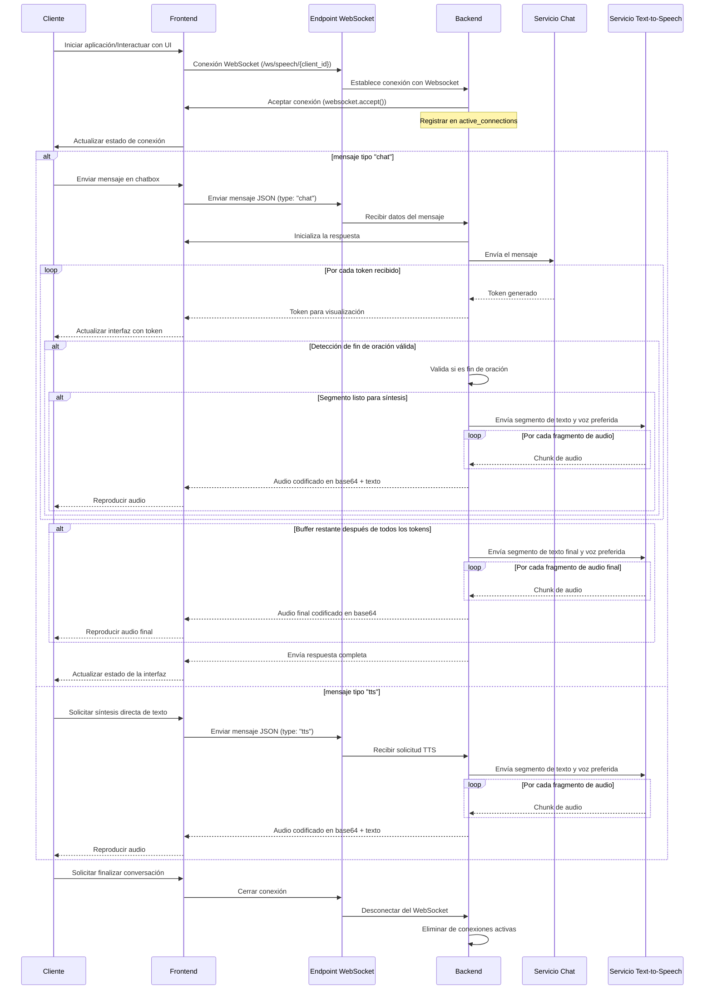

# Chat voz a voz con streaming de audio y texto

El streaming de audio está basado en ejemplos que pueden encontrarse en un repositorio de Azure. 

* [Documentación de Streaming de Azure](https://learn.microsoft.com/es-es/azure/ai-services/speech-service/how-to-lower-speech-synthesis-latency?pivots=programming-language-python). 
* [Repositorio de ejemplos de Streaming con Azure TTS](https://github.com/Azure-Samples/cognitive-services-speech-sdk/tree/23d863be64d5cde6b1559999c1b8aa60dd3912e9/samples/python)
* [Cliente de Azure TTS](https://github.com/Azure-Samples/cognitive-services-speech-sdk/blob/23d863be64d5cde6b1559999c1b8aa60dd3912e9/scenarios/full-duplex-bot/fullduplex/azuretts.py#L51).

### 1. Descripción General

Este diagrama de secuencia representa el flujo de comunicación entre los diferentes componentes del sistema de chat con síntesis de voz en tiempo real. El sistema permite a los usuarios enviar mensajes de texto y recibir respuestas tanto en formato texto como en audio sintetizado.

### 2. Participantes

- **Cliente**: Usuario final que interactúa con la aplicación.
- **Frontend**: Interfaz de usuario desarrollada en Vue.js.
- **Endpoint WebSocket**: Punto de entrada para las conexiones WebSocket.
- **Backend (Router)**: Componente que gestiona las solicitudes y coordina los servicios.
- **Servicio Chat**: Genera las respuestas textuales a los mensajes del usuario.
- **Servicio Text-to-Speech (TTS)**: Convierte el texto en audio utilizando tecnologías de síntesis de voz.

### 3. Flujos Principales

#### 3.1 Establecimiento de Conexión

1. El cliente inicia la aplicación e interactúa con la interfaz de usuario.
2. El frontend establece una conexión WebSocket con el endpoint `/ws/speech/{client_id}`.
3. El backend acepta la conexión mediante `websocket.accept()` y registra la conexión en `active_connections`.
4. El frontend actualiza la interfaz para mostrar el estado de conexión al cliente.

#### 3.2 Procesamiento de Mensajes de Chat

1. El cliente envía un mensaje a través de la interfaz (chatbox).
2. El frontend construye un mensaje JSON con `type: "chat"` y lo envía al endpoint WebSocket.
3. El backend recibe el mensaje e inicializa la respuesta.
4. El backend envía el mensaje al servicio de chat para su procesamiento.
5. Por cada token generado por el servicio de chat:
   - El token se envía al frontend para visualización en tiempo real.
   - El frontend actualiza la interfaz para mostrar el token al cliente.
   - El backend analiza el texto acumulado para detectar finales de oración válidos.
   - Cuando se identifica un segmento completo:
     - El backend lo envía al servicio TTS para su síntesis.
     - El audio generado se envía al frontend codificado en base64.
     - El frontend reproduce el audio para el cliente.
6. Una vez procesados todos los tokens, si queda texto en el buffer:
   - El backend envía el segmento final al servicio TTS.
   - El audio final se envía al frontend y se reproduce para el cliente.
7. El backend envía la respuesta completa al frontend.
8. El frontend actualiza el estado de la interfaz para el cliente.

#### 3.3 Solicitud Directa de Síntesis de Voz (TTS)

1. El cliente solicita la síntesis directa de un texto.
2. El frontend envía un mensaje JSON con `type: "tts"` al endpoint WebSocket.
3. El backend recibe la solicitud y la envía al servicio TTS.
4. El servicio TTS genera fragmentos de audio que son enviados al backend.
5. El backend envía el audio codificado en base64 al frontend.
6. El frontend reproduce el audio para el cliente.

#### 3.4 Finalización de la Conversación

1. El cliente solicita finalizar la conversación.
2. El frontend cierra la conexión WebSocket.
3. El backend detecta la desconexión y elimina la conexión de la lista de conexiones activas.

### 4. Lógica de Detección de Fin de Oración

El sistema implementa una lógica sofisticada para detectar cuándo un signo de puntuación representa un verdadero fin de oración, distinguiendo entre:

- Puntos en números decimales
- Abreviaturas comunes
- URLs y correos electrónicos
- Oraciones completas

Esta detección permite segmentar el texto de manera natural para la síntesis de voz, mejorando la experiencia del usuario al proporcionar audio en fragmentos coherentes.

### 5. Gestión de Errores

Aunque no se muestra explícitamente en el diagrama, el sistema incluye manejo de errores para:

- Mensajes vacíos
- Errores en la síntesis de voz
- Desconexiones inesperadas

### 6. Consideraciones Técnicas

- La comunicación es asíncrona, permitiendo múltiples conexiones simultáneas.
- El sistema utiliza buffers para gestionar el texto y garantizar que la síntesis de voz ocurra en segmentos coherentes.
- La codificación en base64 permite enviar datos binarios (audio) a través del protocolo WebSocket.
- El sistema mantiene un registro de conexiones activas para gestionar eficientemente los recursos.

### 7. Implementación

El backend está implementado en Python utilizando FastAPI para la gestión de WebSockets, mientras que el frontend está desarrollado en Vue.js con composables específicos para manejar la comunicación y la síntesis de voz.

